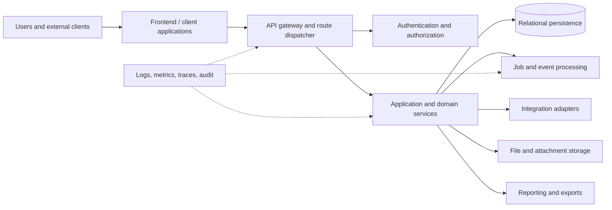

# Architecture Overview

## A. Original Odoo architecture — VERIFIED

The source is a modular monolith. A Python server loads dependency-ordered addons into a shared ORM registry backed by PostgreSQL. HTTP routing, sessions, controllers, XML views/templates, JavaScript/TypeScript assets, cron/background services, reports, bus facilities, and optional integrations are loaded through the framework and addons.

## B. Cloneable logical architecture — implementation contract

The clone should expose equivalent logical boundaries: client, API gateway/router, authentication, application services, domain modules, persistence, asynchronous jobs/events, integration adapters, file storage, reporting, cache, audit/security, and observability. These can be deployed as a modular monolith initially or separated later; separation is an `ASSUMPTION`, not source behavior.

