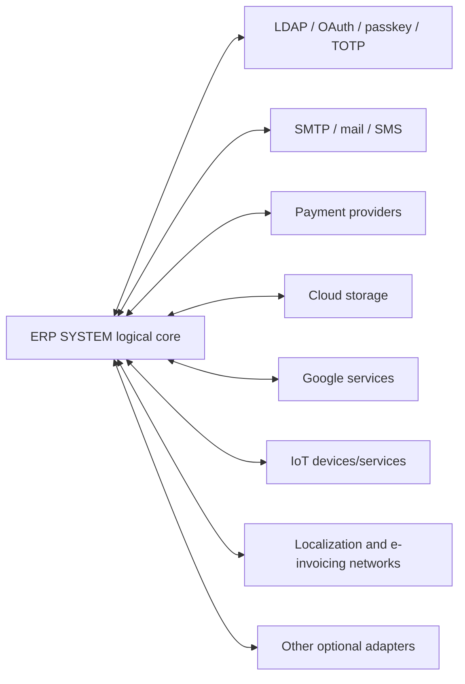

# Integration Architecture

Static evidence identifies 204 integration records and 37 authentication/security capability modules. Integration activation, credentials, rate limits, provider availability, and deployment topology are configuration-dependent.

Clone adapters must isolate provider-specific protocols, protect credentials, define timeout/retry behavior, and expose operational health. Exact provider contracts are specified only when present in the API/integration inventories.
