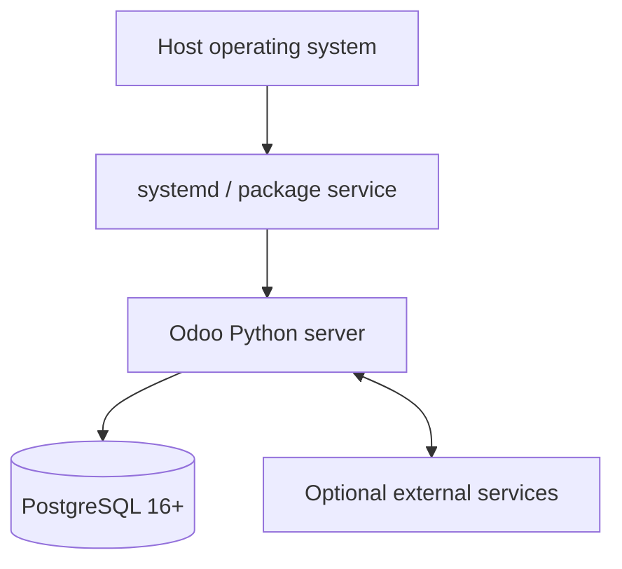

# Deployment Architecture

Verified deployment artifacts include Debian packaging (`debian/`), a systemd unit (`debian/odoo.service`), Debian configuration (`debian/odoo.conf`), Python packaging (`setup.py`), and IOT/Windows setup assets. No Dockerfile, Compose file, Kubernetes manifest, cloud template, or production topology was found in the repository inventory.

Actual process counts, reverse proxy, TLS termination, storage, backup, monitoring, and network segmentation are **Requires Verification** for each deployment.
