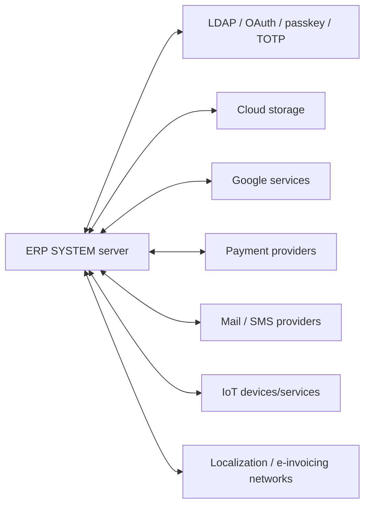

# Integration Architecture

Integration capability is addon-based. Static evidence includes LDAP/OAuth/passkey/TOTP authentication, Google services, cloud storage providers, payment providers, SMS, IoT, localization/e-invoicing, and mail-related modules. Each integration is optional and its credentials/configuration are deployment-specific.

