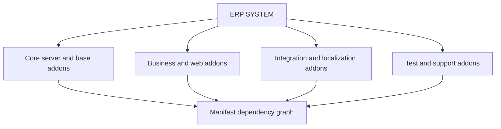

# Module Hierarchy

The repository contains 666 manifest-backed modules. The complete hierarchy is represented by the module catalog and dependency declarations; the following diagram shows the verified structural relationship:

Use `03_MODULE_DOCUMENTATION/Module_Catalog.md` and each linked addon page for the exhaustive module list.

