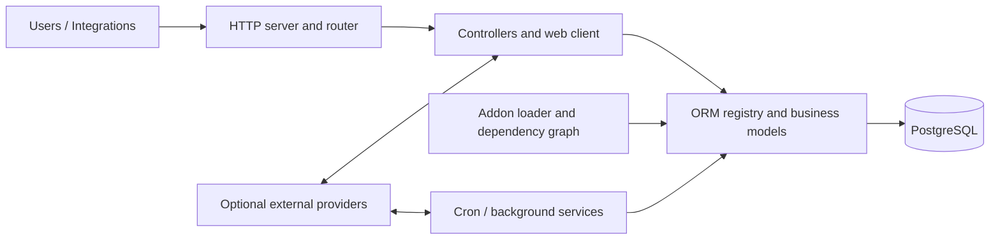

# System Architecture

ERP SYSTEM is a modular monolith. A Python server process loads a dependency-ordered set of addons into a shared ORM registry backed by PostgreSQL. HTTP requests enter through the routing/dispatcher stack; browser assets and XML templates form the client surface. Cron/background services, bus/event facilities, mail, reporting, and optional integrations are loaded through addons and configuration.

Evidence: `odoo-bin`, `odoo/cli/`, `odoo/service/`, `odoo/http/`, `odoo/orm/`, `odoo/sql_db.py`, `odoo/modules/`, and addon manifests.
