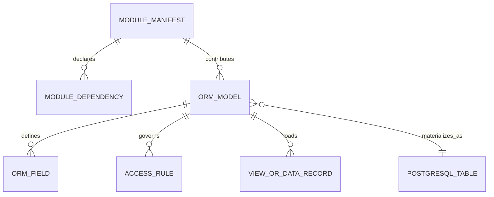

# Entity Relationship Diagram

A complete static ERD for all possible Odoo addons would be misleading because the schema is generated from the installed module graph. The following runtime-level ERD shows verified platform relationships:

`MODULE_MANIFEST`, `ORM_MODEL`, and related nodes are documentation abstractions, not literal database tables. Use `Entity_Dictionary.csv` and a live registry inspection for a deployment-specific ERD.
