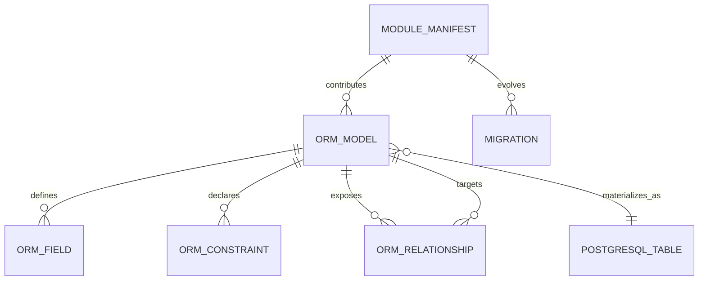

# Entity Relationship Diagram — Phase 6

The source-derived dictionaries contain 4,209 entity declarations and 5,290 relationship fields. A complete all-addon ERD would be misleading because inheritance and installed modules change the deployed schema.

The diagram uses documentation abstractions, not literal database tables. For a deployment-specific ERD, install the selected addon graph, initialize the registry, and export PostgreSQL metadata plus ORM field metadata.
