# Representative ORM Relationship ERD — Phase 6
This diagram is a readable sample of statically extracted relationships. It is not the complete deployed ERD; the full relationship dictionary contains all extracted edges.

```mermaid
erDiagram
  ACCOUNT_ACCOUNT }o--|| RES_CURRENCY : "currency_id"
  ACCOUNT_ACCOUNT }o--o{ ACCOUNT_TAX : "tax_ids"
  ACCOUNT_ACCOUNT }o--o{ RES_COMPANY : "company_ids"
  ACCOUNT_ACCOUNT ||--o{ ACCOUNT_CODE_MAPPING : "code_mapping_ids"
  ACCOUNT_ACCOUNT }o--o{ ACCOUNT_ACCOUNT_TAG : "tag_ids"
  ACCOUNT_ACCOUNT }o--|| ACCOUNT_ROOT : "root_id"
  ACCOUNT_ACCOUNT }o--|| ACCOUNT_ACCOUNT : "parent_id"
  ACCOUNT_ACCOUNT }o--o{ ACCOUNT_ACCOUNT : "parent_ids"
  ACCOUNT_ACCOUNT_TAG }o--|| RES_COUNTRY : "country_id"
  ACCOUNT_ACCOUNT_TAG }o--|| ACCOUNT_REPORT_EXPRESSION : "report_expression_id"
  ACCOUNT_ANALYTIC_DISTRIBUTION_MODEL }o--|| PRODUCT_PRODUCT : "product_id"
  ACCOUNT_ANALYTIC_DISTRIBUTION_MODEL }o--|| PRODUCT_CATEGORY : "product_categ_id"
  ACCOUNT_ANALYTIC_LINE }o--|| PRODUCT_PRODUCT : "product_id"
  ACCOUNT_ANALYTIC_LINE }o--|| ACCOUNT_ACCOUNT : "general_account_id"
  ACCOUNT_ANALYTIC_LINE }o--|| ACCOUNT_JOURNAL : "journal_id"
  ACCOUNT_ANALYTIC_LINE }o--|| ACCOUNT_MOVE_LINE : "move_line_id"
  ACCOUNT_ANALYTIC_LINE }o--o{ UOM_UOM : "allowed_uom_ids"
  ACCOUNT_ANALYTIC_APPLICABILITY }o--|| PRODUCT_CATEGORY : "product_categ_id"
  ACCOUNT_BANK_STATEMENT }o--|| RES_COMPANY : "company_id"
  ACCOUNT_BANK_STATEMENT }o--|| RES_CURRENCY : "currency_id"
  ACCOUNT_BANK_STATEMENT }o--|| ACCOUNT_JOURNAL : "journal_id"
  ACCOUNT_BANK_STATEMENT ||--o{ ACCOUNT_BANK_STATEMENT_LINE : "line_ids"
  ACCOUNT_BANK_STATEMENT }o--o{ IR_ATTACHMENT : "attachment_ids"
  ACCOUNT_BANK_STATEMENT_LINE }o--|| ACCOUNT_MOVE : "move_id"
  ACCOUNT_BANK_STATEMENT_LINE }o--|| ACCOUNT_JOURNAL : "journal_id"
  ACCOUNT_BANK_STATEMENT_LINE }o--|| RES_COMPANY : "company_id"
  ACCOUNT_BANK_STATEMENT_LINE }o--|| ACCOUNT_BANK_STATEMENT : "statement_id"
  ACCOUNT_BANK_STATEMENT_LINE }o--o{ ACCOUNT_PAYMENT : "payment_ids"
  ACCOUNT_BANK_STATEMENT_LINE }o--|| RES_PARTNER : "partner_id"
  ACCOUNT_BANK_STATEMENT_LINE }o--|| RES_CURRENCY : "currency_id"
  ACCOUNT_MOVE ||--o{ ACCOUNT_BANK_STATEMENT_LINE : "statement_line_ids"
  ACCOUNT_CASH_ROUNDING }o--|| ACCOUNT_ACCOUNT : "profit_account_id"
  ACCOUNT_CASH_ROUNDING }o--o{ RES_CURRENCY : "currency_ids"
  ACCOUNT_CASH_ROUNDING }o--o{ RES_PARTNER_CATEGORY : "partner_category_ids"
  ACCOUNT_CASH_ROUNDING }o--o{ ACCOUNT_PAYMENT_METHOD_LINE : "payment_method_line_ids"
  ACCOUNT_CASH_ROUNDING }o--|| RES_COMPANY : "company_id"
  ACCOUNT_CODE_MAPPING }o--|| ACCOUNT_ACCOUNT : "account_id"
  ACCOUNT_CODE_MAPPING }o--|| RES_COMPANY : "company_id"
  ACCOUNT_FULL_RECONCILE ||--o{ ACCOUNT_PARTIAL_RECONCILE : "partial_reconcile_ids"
  ACCOUNT_FULL_RECONCILE ||--o{ ACCOUNT_MOVE_LINE : "reconciled_line_ids"
  ACCOUNT_JOURNAL_GROUP ||--o{ ACCOUNT_JOURNAL : "included_journal_ids"
  ACCOUNT_JOURNAL }o--|| ACCOUNT_ACCOUNT : "default_account_id"
  ACCOUNT_JOURNAL }o--|| RES_CURRENCY : "currency_id"
  ACCOUNT_JOURNAL }o--|| RES_COMPANY : "company_id"
  ACCOUNT_JOURNAL }o--|| IR_ACTIONS_REPORT : "invoice_template_pdf_report_id"
  ACCOUNT_JOURNAL ||--o{ IR_ACTIONS_REPORT : "available_invoice_template_pdf_report_ids"
  ACCOUNT_JOURNAL ||--o{ ACCOUNT_PAYMENT_METHOD_LINE : "inbound_payment_method_line_ids"
  ACCOUNT_JOURNAL }o--|| RES_PARTNER : "company_partner_id"
  ACCOUNT_JOURNAL }o--|| RES_PARTNER_BANK : "bank_account_id"
  ACCOUNT_JOURNAL }o--|| ACCOUNT_JOURNAL_GROUP : "journal_group_id"
  ACCOUNT_JOURNAL }o--o{ ACCOUNT_PAYMENT_METHOD : "available_payment_method_ids"
  ACCOUNT_JOURNAL }o--|| ACCOUNT_BANK_STATEMENT : "last_statement_id"
  ACCOUNT_LOCK_EXCEPTION }o--|| RES_COMPANY : "company_id"
  ACCOUNT_LOCK_EXCEPTION }o--|| RES_USERS : "user_id"
  ACCOUNT_MOVE }o--|| ACCOUNT_JOURNAL : "journal_id"
  ACCOUNT_MOVE }o--|| ACCOUNT_JOURNAL_GROUP : "journal_group_id"
  ACCOUNT_MOVE }o--|| RES_COMPANY : "journal_company_id"
  ACCOUNT_MOVE ||--o{ ACCOUNT_MOVE_LINE : "line_ids"
  ACCOUNT_MOVE ||--o{ ACCOUNT_PARTIAL_RECONCILE : "exchange_diff_partial_ids"
  ACCOUNT_MOVE }o--|| ACCOUNT_PAYMENT : "origin_payment_id"
  ACCOUNT_MOVE }o--o{ ACCOUNT_PAYMENT : "matched_payment_ids"
  ACCOUNT_MOVE }o--|| ACCOUNT_BANK_STATEMENT_LINE : "statement_line_id"
  ACCOUNT_MOVE }o--o{ ACCOUNT_MOVE : "adjusting_entry_origin_move_ids"
  ACCOUNT_MOVE }o--|| ACCOUNT_PARTIAL_RECONCILE : "tax_cash_basis_rec_id"
  ACCOUNT_MOVE }o--|| ACCOUNT_MOVE : "tax_cash_basis_origin_move_id"
  ACCOUNT_MOVE ||--o{ ACCOUNT_MOVE : "tax_cash_basis_created_move_ids"
  ACCOUNT_MOVE }o--o{ ACCOUNT_JOURNAL : "suitable_journal_ids"
  ACCOUNT_MOVE ||--o{ IR_ATTACHMENT : "attachment_ids"
  ACCOUNT_MOVE ||--o{ MAIL_MESSAGE : "audit_trail_message_ids"
  ACCOUNT_MOVE }o--|| ACCOUNT_PAYMENT_TERM : "invoice_payment_term_id"
  ACCOUNT_MOVE }o--|| RES_PARTNER : "partner_id"
  ACCOUNT_MOVE }o--|| RES_PARTNER_BANK : "partner_bank_id"
  ACCOUNT_MOVE }o--|| ACCOUNT_FISCAL_POSITION : "fiscal_position_id"
  ACCOUNT_MOVE }o--|| ACCOUNT_PAYMENT_METHOD_LINE : "preferred_payment_method_line_id"
  ACCOUNT_MOVE }o--|| RES_CURRENCY : "currency_id"
  ACCOUNT_MOVE }o--|| RES_USERS : "invoice_user_id"
  ACCOUNT_MOVE }o--|| IR_ATTACHMENT : "import_source_attachment_id"
  ACCOUNT_MOVE }o--|| ACCOUNT_INCOTERMS : "invoice_incoterm_id"
  ACCOUNT_MOVE }o--|| ACCOUNT_CASH_ROUNDING : "invoice_cash_rounding_id"
  ACCOUNT_MOVE }o--|| RES_COUNTRY : "tax_country_id"
```

## Evidence
Edges are derived from `Relationship_Dictionary.csv`; source file and line evidence are retained in that dictionary. Model names are normalized to Mermaid identifiers for display.
**Displayed edges:** 80  
**Complete extracted relationship rows:** 5,290
