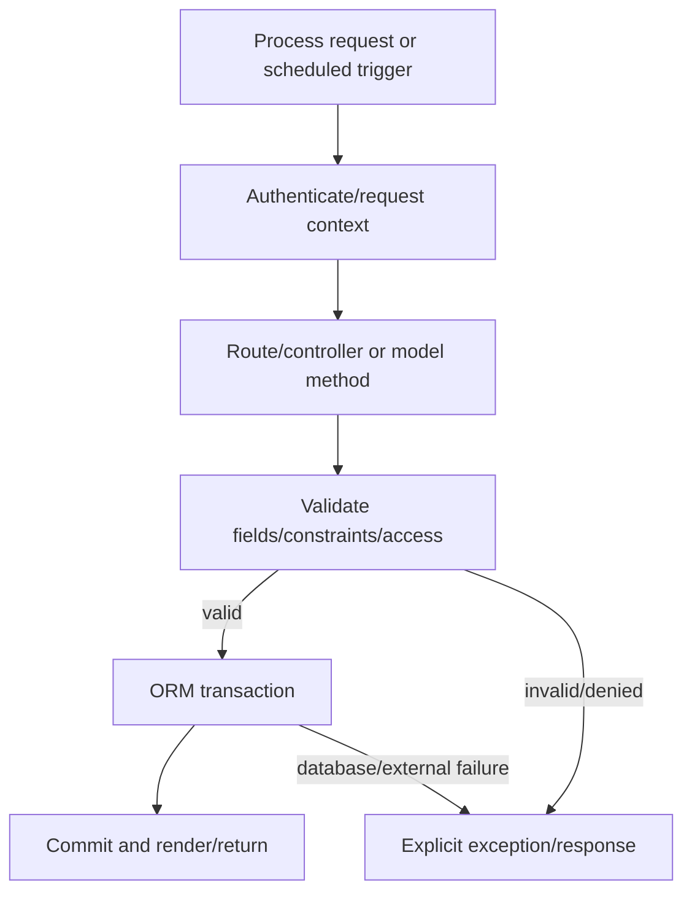

# Business Workflows

The Phase 5 workflow reconstruction is documented in [`Workflow_Catalog.md`](Workflow_Catalog.md), with one evidence row for every module in [`Workflow_Evidence_Inventory.csv`](Workflow_Evidence_Inventory.csv). The diagrams below show the verified platform execution pattern; domain-specific flows remain module and deployment dependent.

This is the verified platform execution pattern. Domain-specific workflows such as purchasing, payroll, manufacturing, or invoicing require the corresponding installed addons and are not generalized here.
