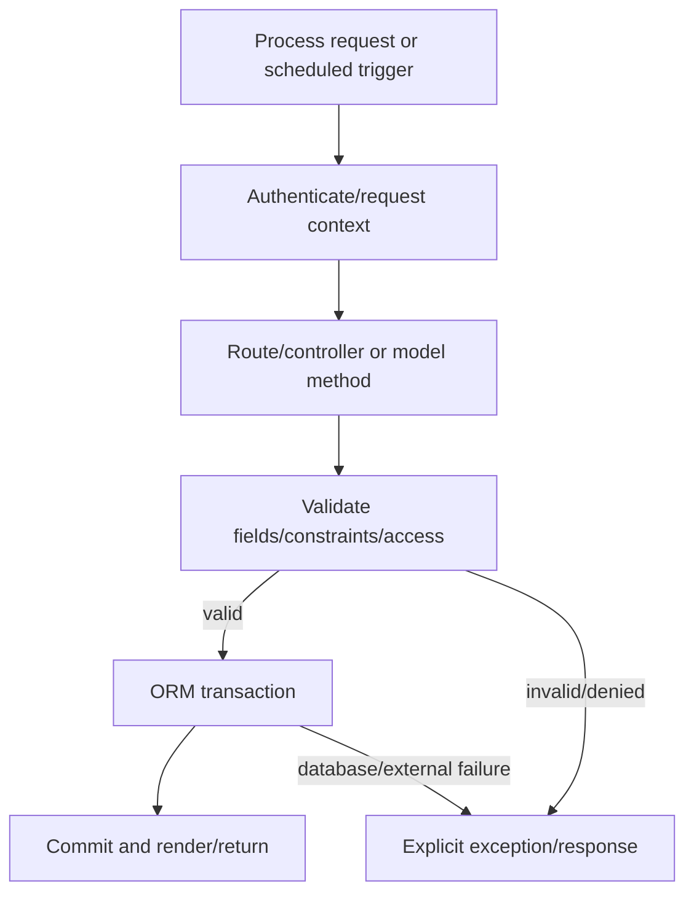

# Business Workflows

This is the verified platform execution pattern. Domain-specific workflows such as purchasing, payroll, manufacturing, or invoicing require the corresponding installed addons and are not generalized here.
