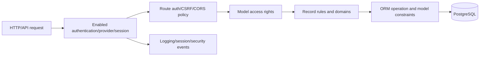

# Security Architecture — Phase 8

## Static security surface

| Evidence | Count |
|---|---:|
| Security-directory files | 279 |
| XML group declarations | 192 |
| XML access-rule declarations | 11 |
| Model access CSV rows | 2,577 |
| Authentication/security-related addon manifests | 37 |
| Security/auth/session/access test files | 587 |
| Route records in security matrix | 669 |

This architecture is source-backed. Effective controls depend on installed addons, loaded XML/CSV data, configuration, user/group assignments, and deployment settings.
