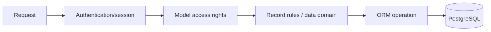

# Security Architecture

The security model combines HTTP/session handling, authentication addons, ORM access rights, record rules, model constraints, and deployment configuration. Static evidence includes 279 access/security files and security-focused test modules.

