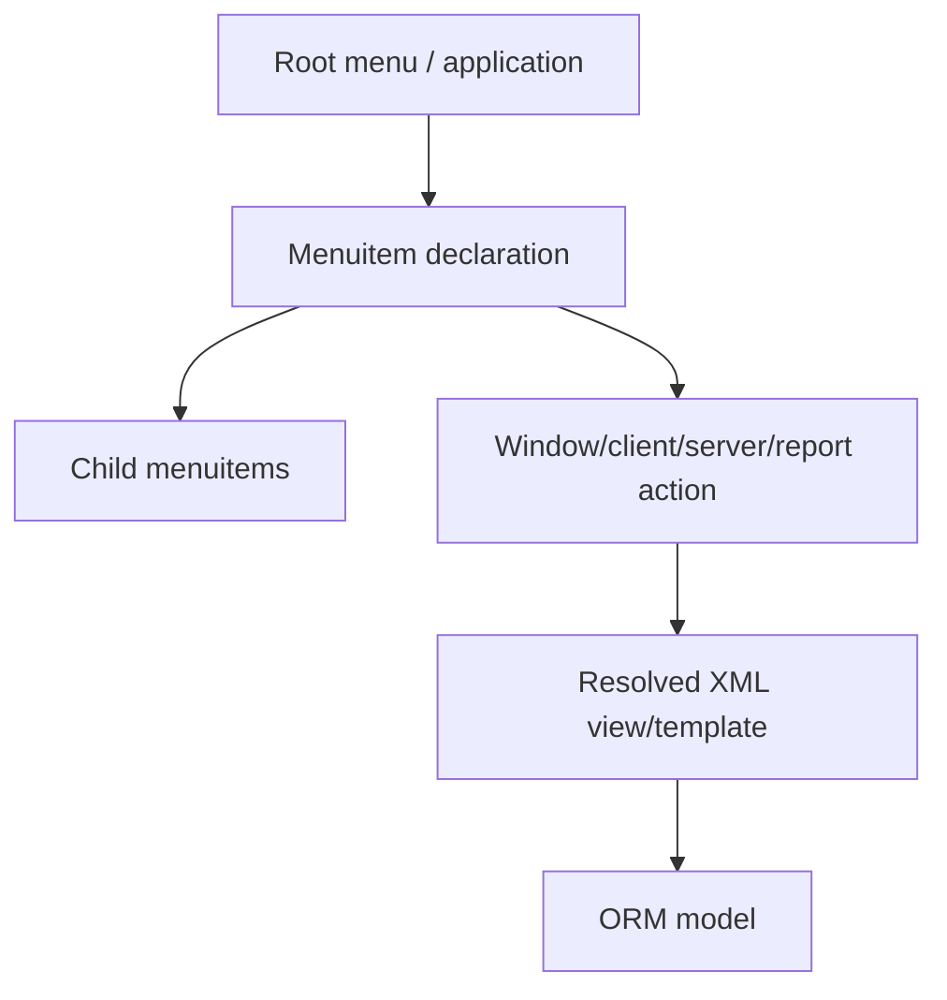

# Navigation Structure — Phase 9

Static extraction found **884 menuitem declarations** and **6,998 action/menu records**. `Menu_Inventory.csv` records XML ID, name, parent, action, and groups.

The effective navigation tree depends on installed modules, XML load order, inherited menu/action updates, and user groups. A static menu declaration does not prove that a user sees or can open the item.
